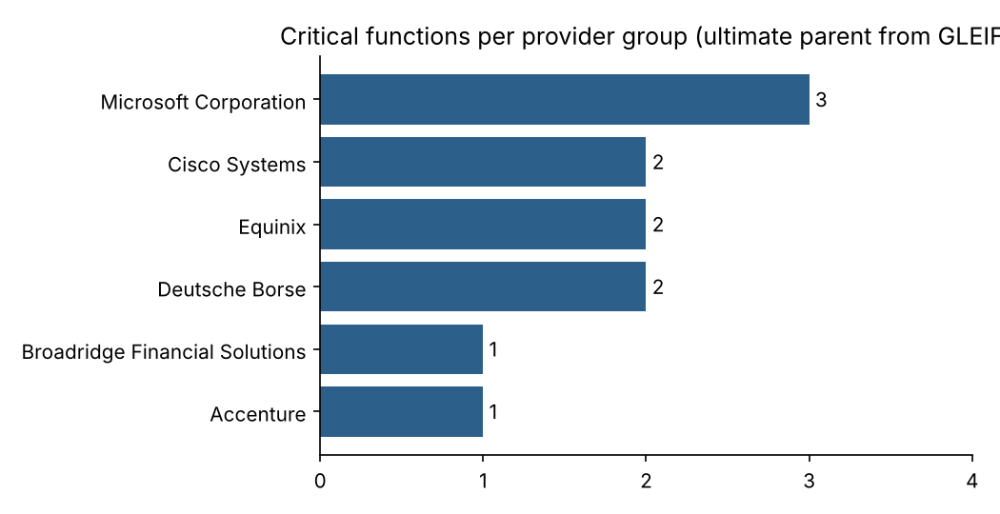

# DORA Register of Information validator

**Find and fix the errors that get a DORA Register of Information rejected, before it reaches the CSSF and the ESAs. Built on real ICT provider data from GLEIF.**

*Résumé en français plus bas.*

## The problem

Since January 2025, the Digital Operational Resilience Act (DORA, Regulation (EU) 2022/2554) requires every bank, investment firm, management company, payment institution and insurer to keep a **Register of Information** on all its ICT third-party contracts. The register follows Implementing Regulation (EU) 2024/2956. Every year it goes to the national authority (the CSSF in Luxembourg), which forwards it to the European Supervisory Authorities (ESAs).

In the ESAs' 2024 dry run:
- only **6.5%** of the 947 registers analysed passed all **116** data quality checks;
- **86%** of the errors were missing mandatory data;
- other frequent errors were invalid LEIs, values outside the allowed lists, duplicate keys and invalid dates.

([ESAs summary report, Dec. 2024](https://www.eba.europa.eu/sites/default/files/2024-12/c1454b59-15cc-445e-be14-966e3338cedc/ESA%202024%2035%20DORA%20Dry%20Run%20exercise%20summary%20report%20for%20publication.pdf))

A rejected register comes back for correction. Meanwhile the data lives in spreadsheets kept by procurement, IT, business owners and risk, and nobody sees the whole picture.

## What this project does

1. **Real provider data** (`src/fetch_providers.py`): looks up the LEI, country, registration status and **ultimate parent** of 23 common ICT providers in the public GLEIF API. Examples: Microsoft, Google Cloud, SWIFT, Bloomberg, Temenos, Avaloq, SimCorp, Clearstream, LuxTrust, POST Luxembourg.
2. **Demo register** (`src/generate.py`): a register for a **fictional** Luxembourg banking group, built on those real providers. It covers 6 templates (B_01.01, B_02.01, B_02.02, B_05.01, B_06.01, B_07.01), 14 functions and 29 contracts.
3. **Validator** (`src/validator.py`):
   - **The 5 check families of the dry run**: mandatory fields (blocking for B_01.01), unique keys, allowed values (ISO country and currency codes, ICT service types S01–S19…), ISO dates, and **LEI validity checked live against GLEIF** (format, check digits, existence, LAPSED or RETIRED status).
   - **Checks the dry run did not run**:
     - links between templates;
     - an LEI that belongs to another company;
     - end date before start date;
     - critical functions without a B_07.01 assessment;
     - root-cause hints: one typo in B_05.01 explains many "not found" errors in B_02.02.
   - **Automatic LEI repair**: for a mistyped LEI, it searches GLEIF by the provider's name and proposes the right code.
   - **Concentration risk**: how many critical functions depend on the same **provider group**, using GLEIF parent links.
4. **Generative AI layer** (`src/explain.py`):
   - the findings become an action list per team (procurement, ICT risk, business owners);
   - Claude can write it as an e-mail, in French or English;
   - the findings always come from the rules;
   - without an API key, a template is used.
5. **Streamlit app** (`app.py`) and **12 tests**. The tests run offline thanks to a GLEIF cache.

## Results

**Detection** (`src/evaluate.py`): 10 runs with 120 errors each, injected with the dry-run mix (86% missing data, 6% LEI, 4% values…) plus 5 error types the dry run did not test.

| Error type | Injected | Detected |
|---|---|---|
| Missing mandatory data | 871 | 100% |
| Mistyped LEI | 53 | 100% (**91% repaired automatically** from GLEIF) |
| Value outside the allowed list | 44 | 100% |
| Invalid date / duplicate key | 14 | 100% |
| LEI of another company / lapsed LEI | 45 | 100% |
| Broken link between templates | 22 | 100% |
| Critical function without assessment | 23 | 100% |
| End date before start date | 19 | 84%* |
| **Total** | **1,091** | **99.7%** |

\* not detectable when the start date on the same row is itself missing or invalid. That error is reported on its own.

**Findings on the real data**:
- **Real registration issue**: on 13 November 2026, GLEIF showed the LEI of **LuxTrust S.A.** (`526700A226529CF0D718`) with registration status **LAPSED**, meaning it had not been renewed. The validator flags it in a register that is otherwise clean. This is the exact type of error behind 6.5% of the dry-run errors.
- **Hidden concentration**: Clearstream (custody) and SimCorp (portfolio management) look like two independent providers. GLEIF shows both belong to **Deutsche Börse**. In the demo register, Microsoft supports 3 critical functions and three groups support 2 each.



## Run it

```bash
pip install -r requirements.txt
python src/fetch_providers.py   # optional: data already in data/
python src/evaluate.py          # detection benchmark + reports
pytest -q                       # offline tests
streamlit run app.py
export ANTHROPIC_API_KEY=...    # optional: e-mails written by Claude
```

## Limits

- 6 of the 15 templates are modelled. Column names are readable; the ITS codes are mapped in `model.py`.
- Allowed values use the readable labels of the ITS annexes, not the coded DPM values of the official taxonomy.
- The rule IDs are this project's own, grouped by the dry run's check families. The project is not the official ESA validation package.
- The banking group and its contracts are fictional. The ICT providers, their LEIs and their parent groups are real (GLEIF, CC0).

---

## Résumé en français

**Problème** : depuis 2025, chaque entité financière doit remettre un registre de tous ses contrats informatiques (règlement DORA). Lors du test des autorités européennes en 2024, seulement **6,5 %** des registres étaient sans erreur, et 86 % des erreurs étaient des données obligatoires manquantes.

**Solution** : un validateur qui applique les 5 familles de contrôles des autorités, plus des contrôles qu'elles n'avaient pas faits :
- cohérence entre les tableaux ;
- LEI vérifiés en direct dans le registre mondial GLEIF ;
- réparation automatique des LEI mal saisis ;
- risque de concentration par groupe de prestataires.

Une IA générative (Claude) rédige ensuite le plan d'action pour chaque équipe.

**Résultats** :
- **99,7 %** des 1 091 erreurs injectées détectées ;
- **91 %** des LEI mal saisis réparés automatiquement ;
- une anomalie réelle trouvée dans GLEIF (LEI expiré chez LuxTrust) ;
- une concentration cachée mise en évidence (Clearstream et SimCorp appartiennent au même groupe, Deutsche Börse).

**Compétences** : Python, pandas, qualité des données, contrôles réglementaires, API REST, réglementation DORA, gestion des risques informatiques et des prestataires, IA générative, Streamlit, tests unitaires.

---
Data: GLEIF, CC0. Author: Martial Bayom.
